# ExplainLoop

**Turn an article's key idea into a short, editable explanatory GIF.**

[简体中文](README.zh-CN.md) · [Skill instructions](SKILL.md) · [MIT license](LICENSE)

[](https://github.com/GraySilver/explainloop/actions/workflows/ci.yml)


> **Original sample article:** “A small team receives requests through email, chat, and an issue tracker. A coordinator ... assigns the research and drafting work to separate specialists. ... The coordinator combines those results into one reply.”
>
> **What the GIF explains:** sources converge, work branches into separate contexts, and a single reply returns. [Read the article](demo/sample-routing-article.md) · [Edit the scene](assets/examples/showcase/21-one-coordinator.scene.mjs)

This example is a **fictional proposed workflow**. It makes no claim about a deployed product or measured improvement.

**Watch:** [20-second silent demo (Chinese captions)](assets/promo/explainloop-demo-20s.mp4) · [Explore nine styles](#see-the-range) · [Open the editable scene](assets/examples/showcase/21-one-coordinator.scene.mjs)

**Design lineage:** Müller-Brockmann's grids, Tschichold's typography, Vignelli's systems, Tufte's information graphics, and Bass's visual storytelling. [See how the ideas shape ExplainLoop](#design-lineage).

## Try it

In Codex, Claude Code, or another agent that can install local Skills, paste this into the chat:

```text
Install this Agent Skill for me: https://github.com/GraySilver/explainloop
Use your current agent's Skills directory. Check that its root SKILL.md is
recognized, then tell me how to use it and which rendering tools are missing.
```

The agent needs access to GitHub and its local Skills directory. If the new Skill does not appear immediately, start a new agent session.

Prefer a terminal? Install for Codex with the [Skills CLI](https://github.com/vercel-labs/skills):

```bash
npx skills add GraySilver/explainloop --skill explainloop -g -a codex -y
```

For Claude Code, use `-a claude-code` instead. The Skills CLI requires Node.js 22.20+. [Manual installation](#manual-installation) is available below.

After installation, give your agent a request it can act on:

```text
Use ExplainLoop with demo/sample-routing-article.md. Make one 16:9 GIF that
shows how the request returns as one reply. Save the editable scene beside it.
```

For your own article, replace the sample path with a local Markdown file, pasted text, or a URL the agent can read. You can name a section, request 1–3 GIFs, choose a style, and specify output ratios or a destination.

## What it does

1. **Find the relationship.** The agent reads the source and identifies a supported sequence, comparison, cause, or change. It records the passage and whether the claim is factual, reported, proposed, or illustrative.
2. **Compose the scene.** It picks a focal object, reading order, style, background, and motion. Scene source is an editable `.scene.mjs` file, not a flattened video.
3. **Render and check.** The deterministic SVG renderer exports a silent GIF. Preview and inspection tools help check reading size, timing, batch style, and output metadata.

ExplainLoop is an **Agent Skill** for Codex, Claude Code, and other compatible agents. Its renderer accepts a finished scene; the CLI does **not** interpret article prose or fetch URLs by itself. URL access depends on the agent's browsing tools. If a page cannot be read, provide its text.

## See the range

The nine GIFs in this style gallery are **1600×900, 16:9 at 30 fps**. Open a GIF to see it at full size, or open its scene to change the motion and layout. The collection deliberately uses different styles; a single request for multiple GIFs keeps one shared style unless you ask for a mix.

| | |
| --- | --- |
| **Nocturne editorial** · requests converge and return as one reply<br><br>[GIF](demo/one-coordinator.gif) · [Scene](assets/examples/showcase/21-one-coordinator.scene.mjs) | **Playful illustrated** · an email becomes a calendar event<br><br>[GIF](demo/08-email-16x9.gif) · [Scene](assets/examples/showcase/08-email-16x9.scene.mjs) |
| **Editorial paper** · attention moves among active sessions<br><br>[GIF](demo/style-editorial-paper.gif) · [Scene](assets/examples/showcase/09-attention-editorial.scene.mjs) | **Swiss grid** · compare two ways to handle messages<br><br>[GIF](demo/style-swiss-grid.gif) · [Scene](assets/examples/showcase/02-swiss-grid.scene.mjs) |
| **Technical blueprint** · one router delegates to isolated workers<br><br>[GIF](demo/style-technical-blueprint.gif) · [Scene](assets/examples/showcase/10-router-atelier-16x9.scene.mjs) | **Data newsroom** · compare two reported token counts<br><br>[GIF](demo/style-data-newsroom.gif) · [Scene](assets/examples/showcase/15-data-16x9.scene.mjs) |
| **Archival timeline** · three fictional releases in sequence<br><br>[GIF](demo/style-archival-timeline.gif) · [Scene](assets/examples/showcase/06-archival-timeline.scene.mjs) | **Museum gallery** · inspect a source before recording an outcome<br><br>[GIF](demo/style-museum-gallery.gif) · [Scene](assets/examples/showcase/11-museum-gallery.scene.mjs) |
| **Chromatic poster** · paths gather into one result<br><br>[GIF](demo/background-ribbon-field-motion.gif) · [Scene](assets/examples/backgrounds/ribbon-field-motion.scene.mjs) | |

The Skill includes **9 style presets, 10 background treatments, and 30 semantic components** for people, messages, documents, tasks, timelines, charts, and UI states. A batch keeps one visual language even when scenes use different layouts.

### Style and component boards

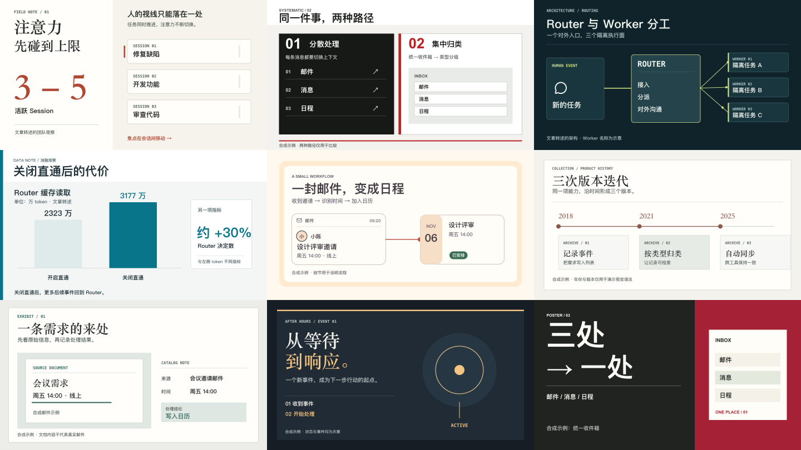

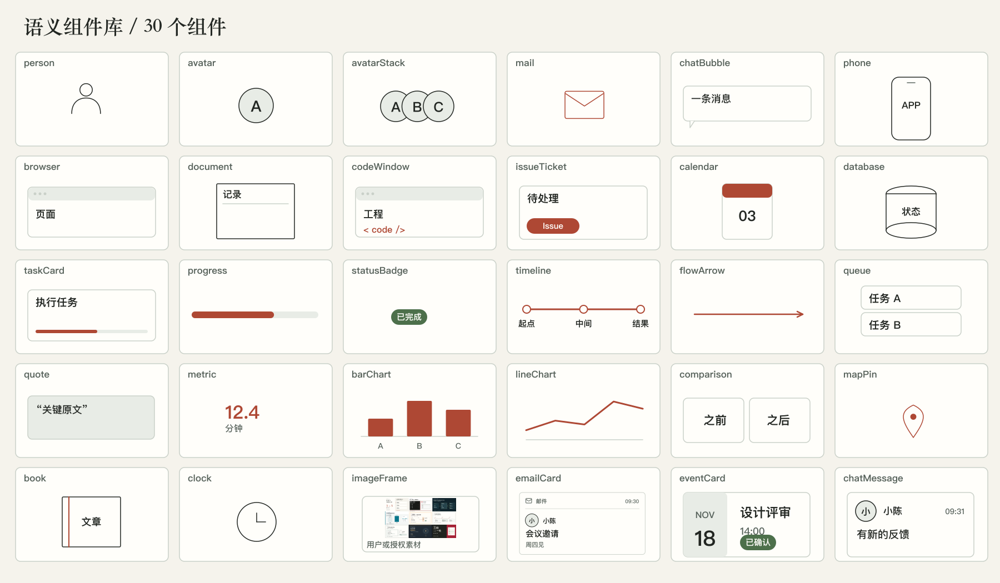

### Background treatments

The overview sheets show all ten treatments and a closer view of six. The individual 16:9 previews below link to editable scenes. [How to choose a background](references/backgrounds.md)


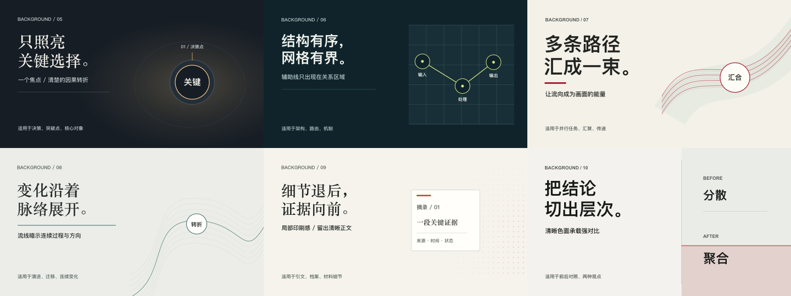

| | |
| --- | --- |
| **Soft wash**<br><br>[Scene](assets/examples/backgrounds/soft-wash.scene.mjs) | **Edge glow**<br>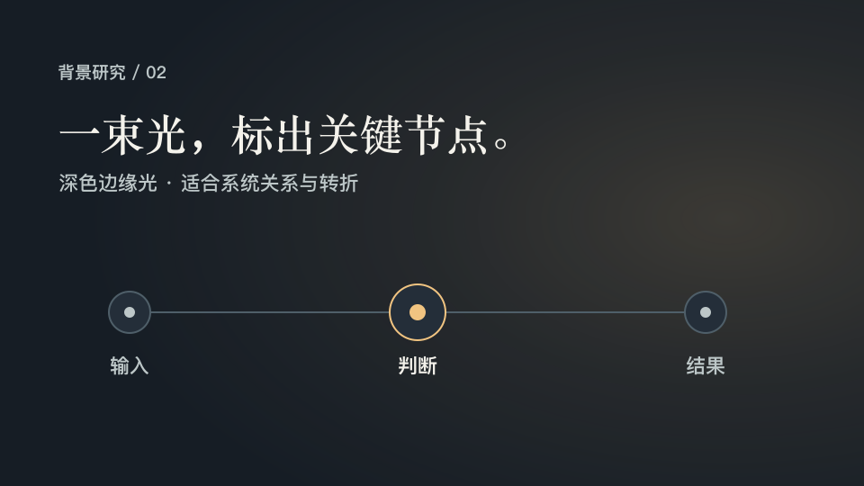<br>[Scene](assets/examples/backgrounds/edge-glow.scene.mjs) |
| **Layered matte**<br>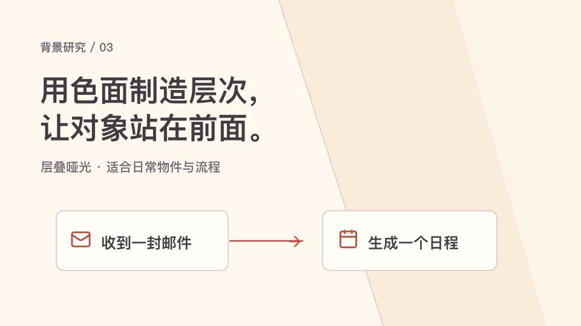<br>[Scene](assets/examples/backgrounds/layered-matte.scene.mjs) | **Quiet motif**<br><br>[Scene](assets/examples/backgrounds/quiet-motif.scene.mjs) |
| **Focus halo**<br>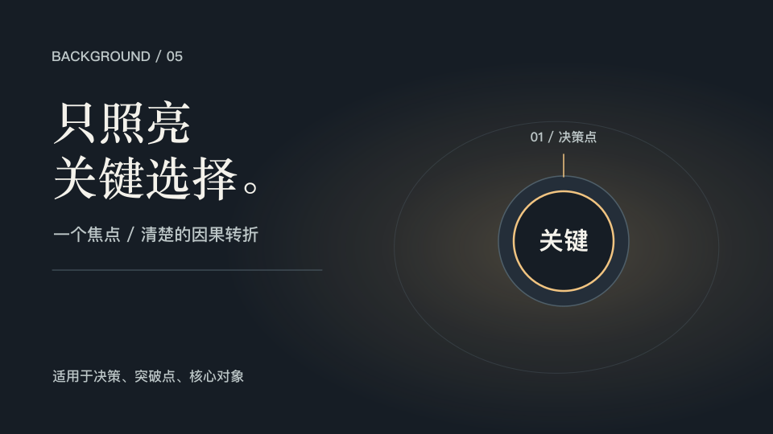<br>[Scene](assets/examples/backgrounds/focus-halo.scene.mjs) | **Clipped grid**<br>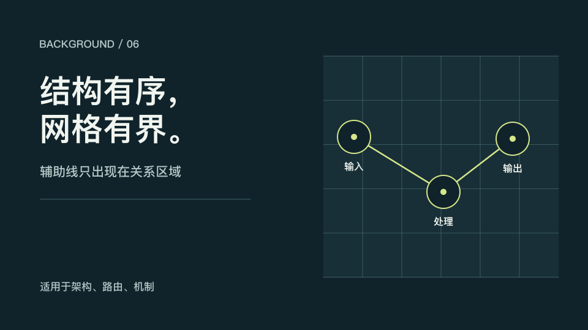<br>[Scene](assets/examples/backgrounds/clipped-grid.scene.mjs) |
| **Ribbon field**<br>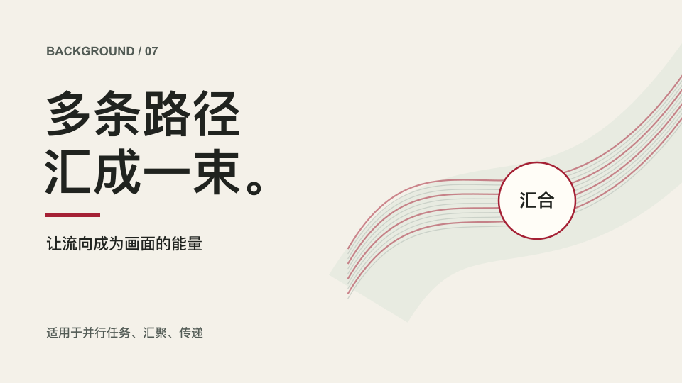<br>[Scene](assets/examples/backgrounds/ribbon-field.scene.mjs) | **Contour lines**<br>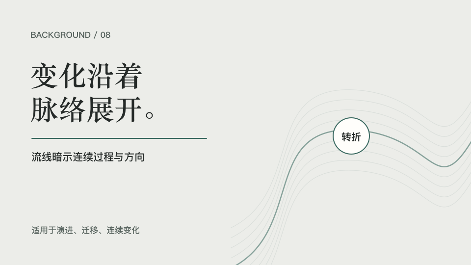<br>[Scene](assets/examples/backgrounds/contour-lines.scene.mjs) |
| **Halftone margin**<br><br>[Scene](assets/examples/backgrounds/halftone-margin.scene.mjs) | **Editorial band**<br>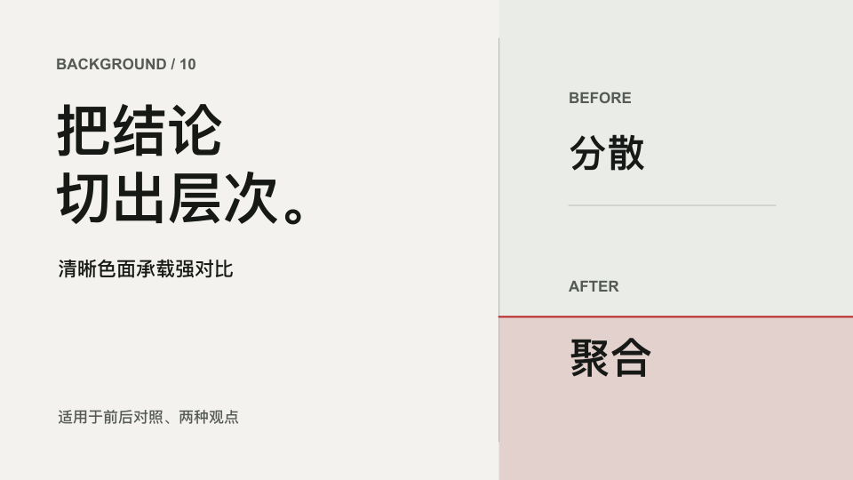<br>[Scene](assets/examples/backgrounds/editorial-band.scene.mjs) |

### Portrait examples

The style gallery above stays 16:9. These separate 9:16 previews show how a scene and two backgrounds recompose for a narrow canvas.

| Email workflow | Soft wash | Focus halo |
| --- | --- | --- |
| <br>[GIF](demo/08-email-9x16.gif) · [Scene](assets/examples/showcase/08-email-9x16.scene.mjs) | <br>[Scene](assets/examples/backgrounds/soft-wash-9x16.scene.mjs) | 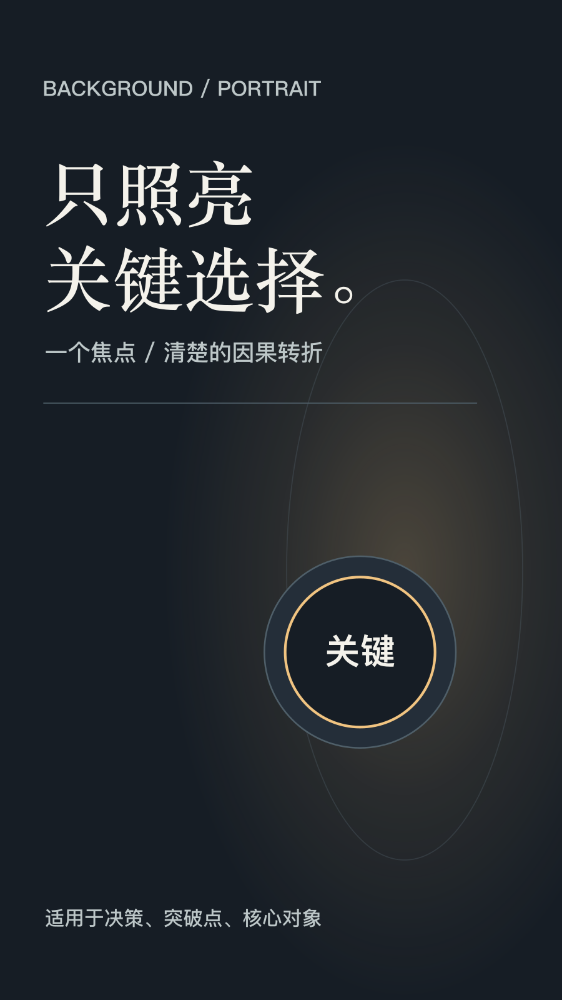<br>[Scene](assets/examples/backgrounds/focus-halo-9x16.scene.mjs) |

The default is **1600×900, 30 fps, 4–7 seconds**. Built-in layouts also cover 4:3, square, and 9:16; custom output sizes with a matching scene ratio are supported. Portrait scenes are recomposed rather than cropped from landscape.

## Design lineage

An explanatory GIF has very little time to earn attention. ExplainLoop uses type to establish the claim, composition to show the relationship, and motion to reveal the change. The design references below are public, documented approaches that help us make those decisions for original scenes.

| Designer and reference | Idea we study | How it appears in ExplainLoop |
| --- | --- | --- |
| [Josef Müller-Brockmann · *The Swiss Grid*](https://swissgrid.posterhouse.org/) | A flexible grid gives unrelated elements a clear visual relationship. | The `swiss-grid` preset aligns comparisons and labels so the reader can scan two paths at a glance. |
| [Jan Tschichold · *The New Typography*](https://www.moma.org/calendar/exhibitions/1013) | Asymmetry, type scale, and open space can guide reading before decoration does. | `editorial-paper` and `chromatic-poster` use decisive type hierarchy and deliberately uneven compositions. |
| [Massimo Vignelli · *The Vignelli Canon*](https://www.lars-mueller-publishers.com/vignelli-canon) | Semantics, coherence, grids, type, and color belong to one disciplined system. | A multi-GIF batch shares its typography, palette, spacing, and motion character even when each scene has a different layout. |
| [Edward Tufte · *The Visual Display of Quantitative Information*](https://www.edwardtufte.com/book/the-visual-display-of-quantitative-information/) | Graphics should make comparisons precise and avoid visual distortion. | `data-newsroom` keeps units and direct labels near the marks, starts comparison bars at zero, and preserves source qualifiers. |
| [Otto Neurath and Gerd Arntz · Isotype](https://www.cooperhewitt.org/2013/08/06/picturing-language/) | A consistent picture language can make complex information easier to read. | Semantic people, message, document, task, and timeline components give each object a recognizable role. The bundled icon artwork is credited separately to Lucide. |
| [Paula Scher · *Type Is Image*](https://www.pentagram.com/news/paula-scher-type-is-image-opens-at-die-neue-sammlung) | Type can carry the emotion and identity of a composition. | Large words become the focal object in `chromatic-poster`; scale and color serve the article's point. |
| [Saul Bass · film titles and posters](https://eyeondesign.aiga.org/design-history-101/) | A short visual sequence can condense a larger idea into one memorable image. | Each loop is planned around one visible transformation and a readable final frame. |
| [Dieter Rams · principles for good design](https://www.vitsoe.com/us/about/good-design) | Useful detail earns its place; unnecessary detail makes the message harder to see. | Background texture, UI chrome, and motion are reduced whenever they compete with the article's claim. |

These are references for design principles, with our adaptation described in the last column. **All shipped scenes and layouts are original; no designer or institution listed here endorses or collaborates on ExplainLoop.** Their artwork and fonts are not bundled. [See the full source and license notes](references/sources-and-licenses.md).

## Requirements and manual installation

Rendering needs Node.js 20+, `rsvg-convert` from [librsvg](https://wiki.gnome.org/Projects/LibRsvg), and `ffmpeg` plus `ffprobe` from [FFmpeg](https://ffmpeg.org/). The Skills CLI used above has its own Node.js 22.20+ requirement. Fonts are not bundled; install an appropriate Chinese font to reproduce the Chinese examples.

To install without the Skills CLI, clone the repository and link its root into your agent's skill directory:

```bash
git clone https://github.com/GraySilver/explainloop.git
cd explainloop
mkdir -p "$HOME/.codex/skills"
ln -s "$PWD" "$HOME/.codex/skills/explainloop"
```

For Claude Code, use `"$HOME/.claude/skills/explainloop"` as the link destination. Back up an existing destination before linking. Restart the agent if it does not discover the Skill immediately.

## Render an included scene

From the repository root:

```bash
node scripts/render.mjs \
  --scene "$PWD/assets/examples/showcase/21-one-coordinator.scene.mjs" \
  --out "$PWD/example.gif" --output-size 1600x900
node scripts/inspect.mjs "$PWD/example.gif"
```

Run `node scripts/test.mjs` to check the renderer, scenes, layout profiles, and batch style rules. The renderer deletes its temporary frame files after export.

## License and attribution

Original code, Skill instructions, and example artwork are [MIT licensed](LICENSE). The bundled Lucide icons retain their [ISC/MIT notices](assets/icons/LICENSE) and [provenance record](assets/icons/PROVENANCE.md). The [source guide](references/sources-and-licenses.md) credits design research; third-party artwork and font files are not bundled.
