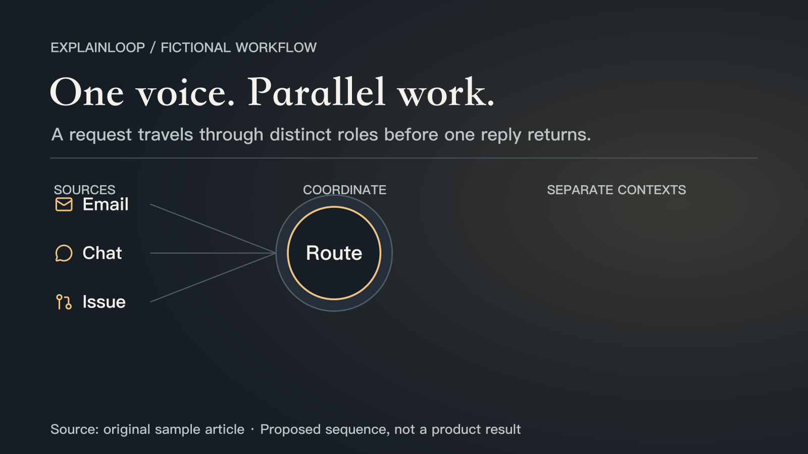
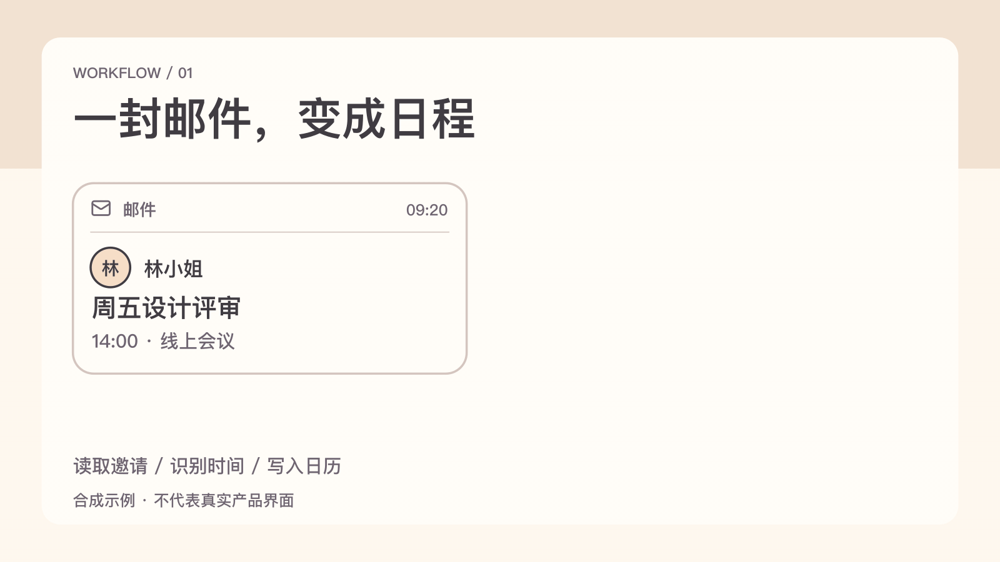
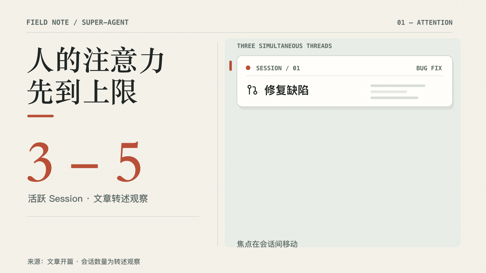
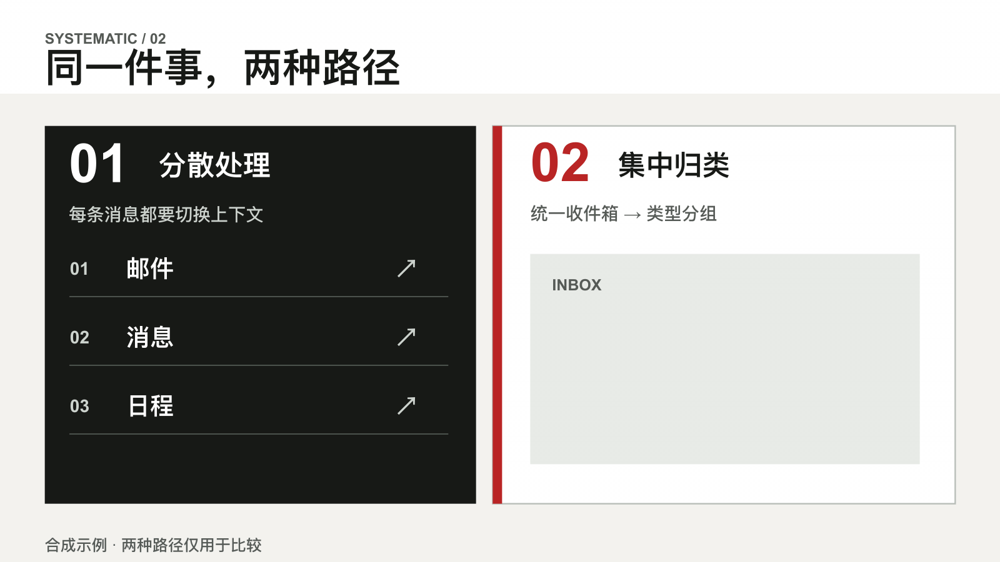
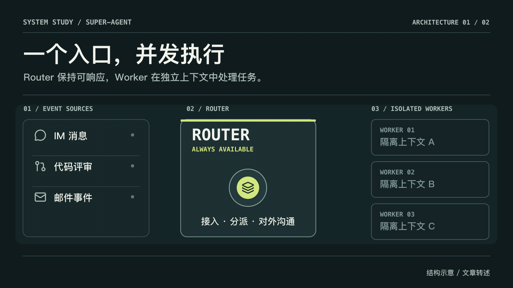
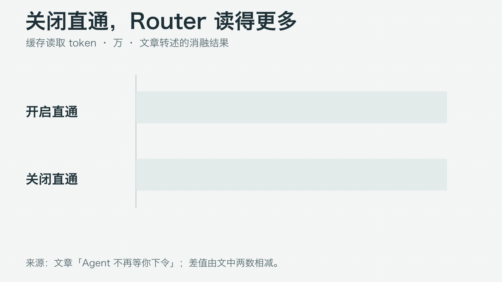
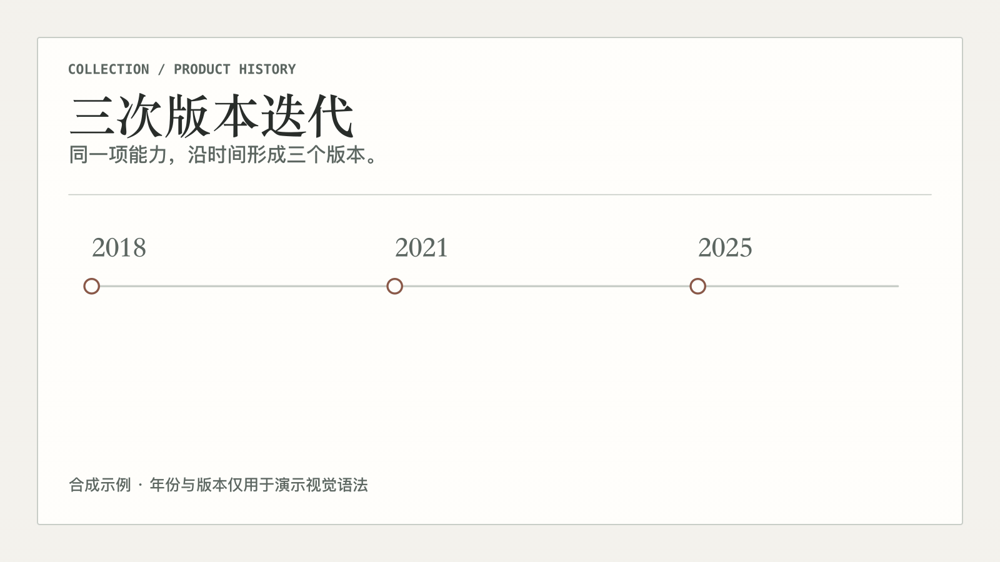
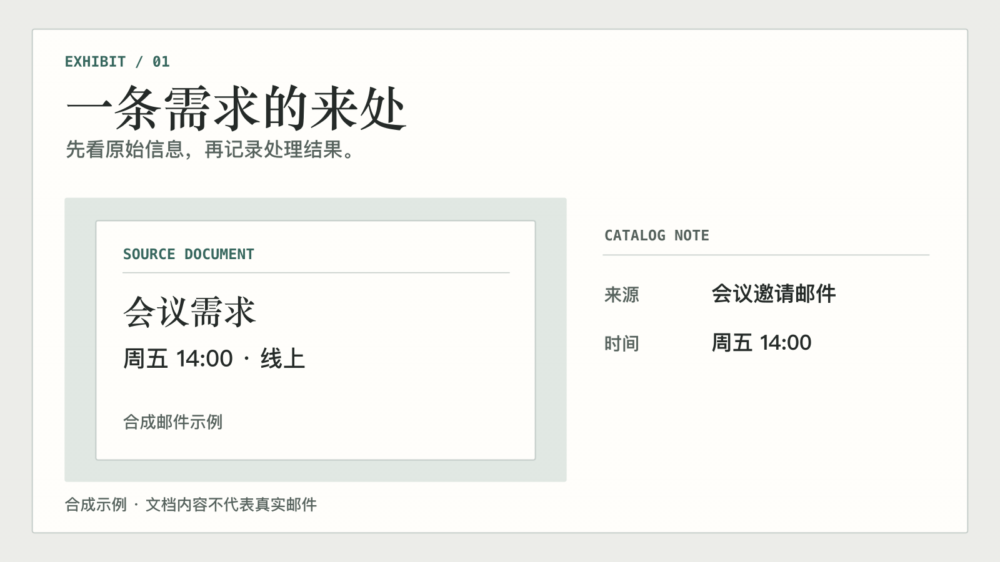
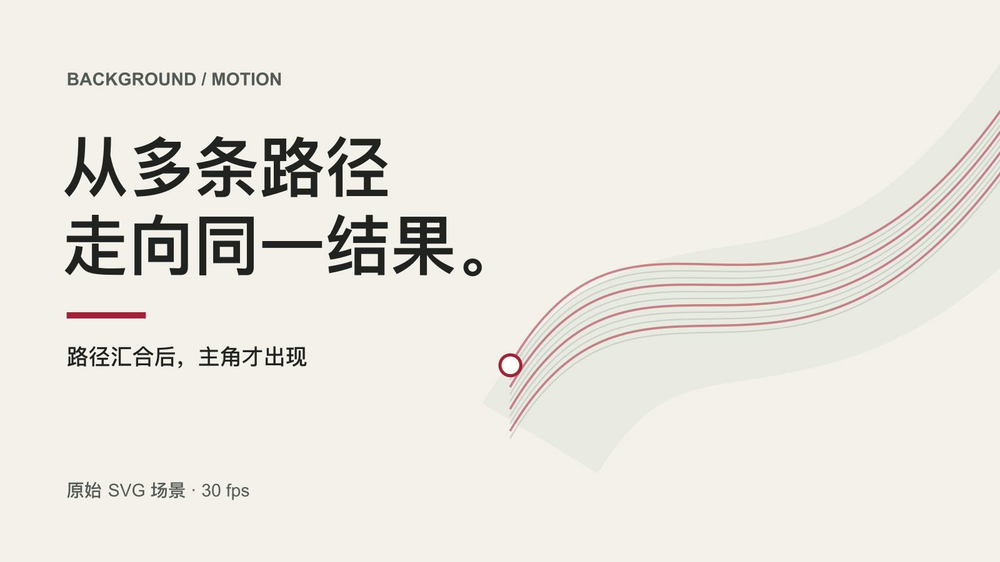

# ExplainLoop

**Turn an article's key idea into a short, editable explanatory GIF.**

[简体中文](README.zh-CN.md) · [Skill instructions](SKILL.md) · [MIT license](LICENSE)

[](https://github.com/GraySilver/explainloop/actions/workflows/ci.yml)



> **Original sample article:** “A small team receives requests through email, chat, and an issue tracker. A coordinator ... assigns the research and drafting work to separate specialists. ... The coordinator combines those results into one reply.”
>
> **What the GIF explains:** sources converge, work branches into separate contexts, and a single reply returns. [Read the article](demo/sample-routing-article.md) · [Edit the scene](assets/examples/showcase/21-one-coordinator.scene.mjs)

This example is a **fictional proposed workflow**. It makes no claim about a deployed product or measured improvement.

## Try it

Install for Codex with the [Skills CLI](https://github.com/vercel-labs/skills):

```bash
npx skills add GraySilver/explainloop --skill explainloop -g -a codex -y
```

For Claude Code, use `-a claude-code` instead. The Skills CLI requires Node.js 22.20+. [Manual installation](#manual-installation) is available below.

Then give your agent a request it can act on:

```text
Use ExplainLoop with demo/sample-routing-article.md. Make one 16:9 GIF that
shows how the request returns as one reply. Save the editable scene beside it.
```

For your own article, replace the sample path with a local Markdown file, pasted text, or a URL the agent can read. You can name a section, request 1–3 GIFs, choose a style, and specify output ratios or a destination.

## What it does

1. **Find the relationship.** The agent reads the source and identifies a supported sequence, comparison, cause, or change. It records the passage and whether the claim is factual, reported, proposed, or illustrative.
2. **Compose the scene.** It picks a focal object, reading order, style, background, and motion. Scene source is an editable `.scene.mjs` file, not a flattened video.
3. **Render and check.** The deterministic SVG renderer exports a silent GIF. Preview and inspection tools help check reading size, timing, batch style, and output metadata.

ExplainLoop is an **Agent Skill** for Codex, Claude Code, and other compatible agents. Its renderer accepts a finished scene; the CLI does **not** interpret article prose or fetch URLs by itself. URL access depends on the agent's browsing tools. If a page cannot be read, provide its text.

## See the range

Every preview below is a **1600×900, 16:9 GIF at 30 fps**. Open a GIF to see it at full size, or open its scene to change the motion and layout. The collection deliberately uses different styles; a single request for multiple GIFs keeps one shared style unless you ask for a mix.

| | |
| --- | --- |
| **Nocturne editorial** · requests converge and return as one reply<br><br>[GIF](demo/one-coordinator.gif) · [Scene](assets/examples/showcase/21-one-coordinator.scene.mjs) | **Playful illustrated** · an email becomes a calendar event<br><br>[GIF](demo/08-email-16x9.gif) · [Scene](assets/examples/showcase/08-email-16x9.scene.mjs) |
| **Editorial paper** · attention moves among active sessions<br><br>[GIF](demo/style-editorial-paper.gif) · [Scene](assets/examples/showcase/09-attention-editorial.scene.mjs) | **Swiss grid** · compare two ways to handle messages<br><br>[GIF](demo/style-swiss-grid.gif) · [Scene](assets/examples/showcase/02-swiss-grid.scene.mjs) |
| **Technical blueprint** · one router delegates to isolated workers<br><br>[GIF](demo/style-technical-blueprint.gif) · [Scene](assets/examples/showcase/10-router-atelier-16x9.scene.mjs) | **Data newsroom** · compare two reported token counts<br><br>[GIF](demo/style-data-newsroom.gif) · [Scene](assets/examples/showcase/15-data-16x9.scene.mjs) |
| **Archival timeline** · three fictional releases in sequence<br><br>[GIF](demo/style-archival-timeline.gif) · [Scene](assets/examples/showcase/06-archival-timeline.scene.mjs) | **Museum gallery** · inspect a source before recording an outcome<br><br>[GIF](demo/style-museum-gallery.gif) · [Scene](assets/examples/showcase/11-museum-gallery.scene.mjs) |
| **Chromatic poster** · paths gather into one result<br><br>[GIF](demo/background-ribbon-field-motion.gif) · [Scene](assets/examples/backgrounds/ribbon-field-motion.scene.mjs) | |

The Skill includes **9 style presets, 10 background treatments, and 30 semantic components** for people, messages, documents, tasks, timelines, charts, and UI states. [Browse the background guide](references/backgrounds.md) or [see six background treatments](demo/backgrounds-new.png). A batch keeps one visual language even when scenes use different layouts.

The default is **1600×900, 30 fps, 4–7 seconds**. Built-in layouts also cover 4:3, square, and 9:16; custom output sizes with a matching scene ratio are supported. Portrait scenes are recomposed rather than cropped from landscape.

## Requirements and manual installation

Rendering needs Node.js 20+, `rsvg-convert` from [librsvg](https://wiki.gnome.org/Projects/LibRsvg), and `ffmpeg` plus `ffprobe` from [FFmpeg](https://ffmpeg.org/). The Skills CLI used above has its own Node.js 22.20+ requirement. Fonts are not bundled; install an appropriate Chinese font to reproduce the Chinese examples.

To install without the Skills CLI, clone the repository and link its root into your agent's skill directory:

```bash
git clone https://github.com/GraySilver/explainloop.git
cd explainloop
mkdir -p "$HOME/.codex/skills"
ln -s "$PWD" "$HOME/.codex/skills/explainloop"
```

For Claude Code, use `"$HOME/.claude/skills/explainloop"` as the link destination. Back up an existing destination before linking. Restart the agent if it does not discover the Skill immediately.

## Render an included scene

From the repository root:

```bash
node scripts/render.mjs \
  --scene "$PWD/assets/examples/showcase/21-one-coordinator.scene.mjs" \
  --out "$PWD/example.gif" --output-size 1600x900
node scripts/inspect.mjs "$PWD/example.gif"
```

Run `node scripts/test.mjs` to check the renderer, scenes, layout profiles, and batch style rules. The renderer deletes its temporary frame files after export.

## License and attribution

Original code, Skill instructions, and example artwork are [MIT licensed](LICENSE). The bundled Lucide icons retain their [ISC/MIT notices](assets/icons/LICENSE) and [provenance record](assets/icons/PROVENANCE.md). The [source guide](references/sources-and-licenses.md) credits design research; third-party artwork and font files are not bundled.
