# ExplainLoop

**把文章中的关键关系，变成简短、可编辑的解释型 GIF。**

[English](README.md) · [Skill 说明](SKILL.md) · [MIT 许可证](LICENSE)

[](https://github.com/GraySilver/explainloop/actions/workflows/ci.yml)

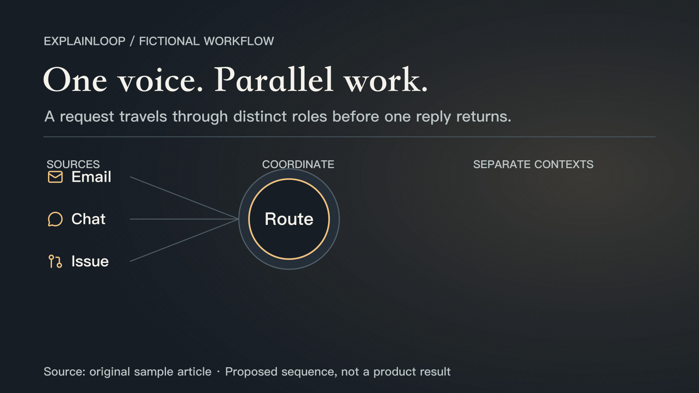

> **原创示例文章：**团队通过邮件、聊天和工单收到请求。协调者把研究与起草交给不同角色；结果返回后，再由协调者合成一条回复。
>
> **动画解释的关系：**来源汇合、工作分流、结果回到同一出口。[阅读原文](demo/sample-routing-article.md) · [编辑场景](assets/examples/showcase/21-one-coordinator.scene.mjs)

这是**虚构的提案流程**，不代表已经上线的产品或经过测量的效率提升。

**快速了解：**[20 秒无声演示](assets/promo/explainloop-demo-20s.mp4) · [查看九种风格](#示例与规格) · [打开可编辑场景](assets/examples/showcase/21-one-coordinator.scene.mjs)

**设计脉络：**穆勒-布罗克曼的网格、奇肖尔德的排版、维涅里的系统设计、塔夫特的信息图，以及索尔·巴斯的视觉叙事。[看看这些方法如何进入 ExplainLoop](#设计脉络)。

## 立即试用

在 Codex、Claude Code 等支持安装本地 Skill 的 Agent 中，直接发送：

```text
帮我安装这个 Agent Skill：https://github.com/GraySilver/explainloop
请安装到你当前使用的 Skills 目录，确认仓库根目录的 SKILL.md 能被识别，
然后告诉我怎么使用，以及还缺少哪些 GIF 渲染工具。
```

Agent 需要能访问 GitHub 和本地 Skills 目录。如果安装后没有立即出现新 Skill，请开启新的 Agent 会话。

习惯用命令行？使用 [Skills CLI](https://github.com/vercel-labs/skills) 安装到 Codex：

```bash
npx skills add GraySilver/explainloop --skill explainloop -g -a codex -y
```

Claude Code 将 `-a codex` 改为 `-a claude-code`。Skills CLI 需要 Node.js 22.20+；下方也有[手动安装方法](#手动安装与运行环境)。

安装完成后，向 Agent 发送：

```text
使用 ExplainLoop 处理 demo/sample-routing-article.md。生成一张 16:9 的 GIF，
解释请求如何经过不同角色，最后由同一个入口回复。把可编辑场景源码一起保存。
```

换成你自己的 Markdown 文件、粘贴文本或 Agent 可读取的 URL 即可。你也可以指定文章章节、1–3 张 GIF、风格、比例和输出目录。

## 工作方式

1. **找出值得动起来的关系。** Agent 阅读原文，选择有依据的步骤、对照、因果或变化，并记录事实、转述、提案与示意的区别。
2. **编排可编辑场景。** 确定主体、阅读顺序、风格、背景和动效，产出 `.scene.mjs` 源码。
3. **渲染并检查。** SVG 渲染器导出无声 GIF；预览和检查脚本核对画面、节奏、批次一致性与输出规格。

ExplainLoop 是面向 Codex、Claude Code 等 Agent 的 **Skill**。渲染 CLI 接收已经写好的场景，**不会独立理解文章或抓取 URL**；网页能否读取取决于 Agent 的浏览能力，访问失败时需要提供正文。

## 示例与规格

这组九张风格 GIF 均为 **1600×900、16:9、30 fps**。点击原图可看完整尺寸，点击场景可修改布局和动画。这组展示刻意使用不同风格；同一次请求生成多张 GIF 时，默认仍会统一风格，除非你指定混合风格。

| | |
| --- | --- |
| **夜色编辑风** · 多渠道汇合与统一回复<br><br>[原图](demo/one-coordinator.gif) · [场景](assets/examples/showcase/21-one-coordinator.scene.mjs) | **轻巧插画风** · 邮件变成日历事件<br><br>[原图](demo/08-email-16x9.gif) · [场景](assets/examples/showcase/08-email-16x9.scene.mjs) |
| **纸张编辑风** · 注意力在活跃会话间移动<br>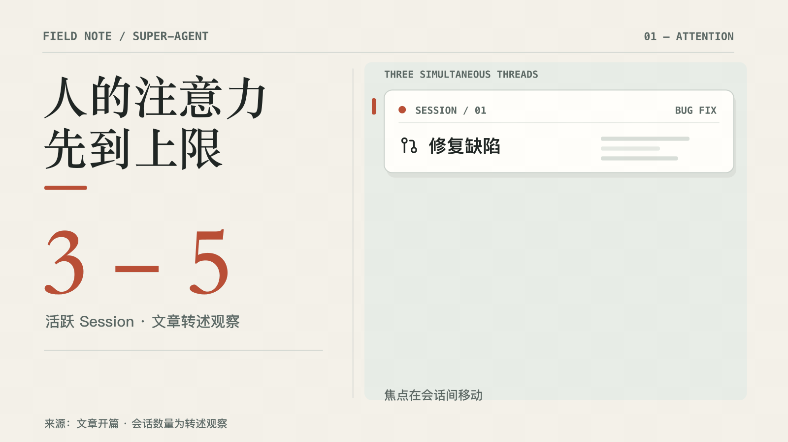<br>[原图](demo/style-editorial-paper.gif) · [场景](assets/examples/showcase/09-attention-editorial.scene.mjs) | **瑞士网格风** · 对照两种消息处理路径<br>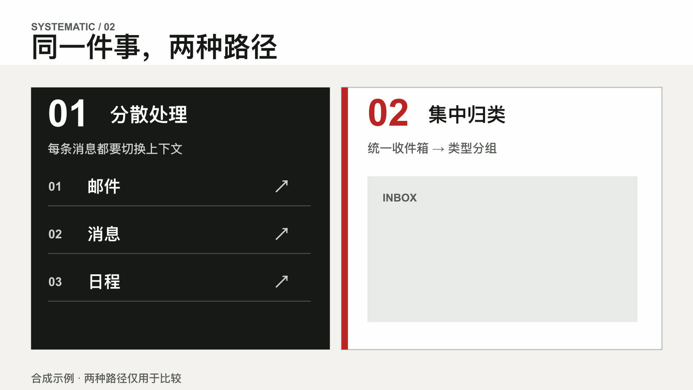<br>[原图](demo/style-swiss-grid.gif) · [场景](assets/examples/showcase/02-swiss-grid.scene.mjs) |
| **技术蓝图风** · Router 分派给隔离的 Worker<br>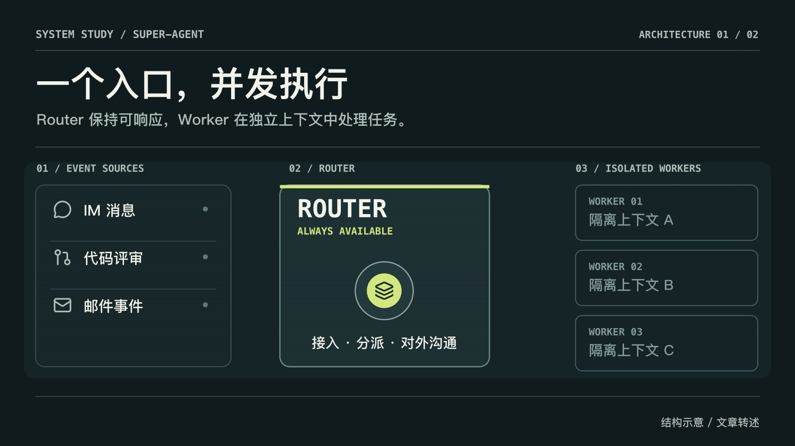<br>[原图](demo/style-technical-blueprint.gif) · [场景](assets/examples/showcase/10-router-atelier-16x9.scene.mjs) | **数据新闻风** · 对照文章转述的缓存读取量<br>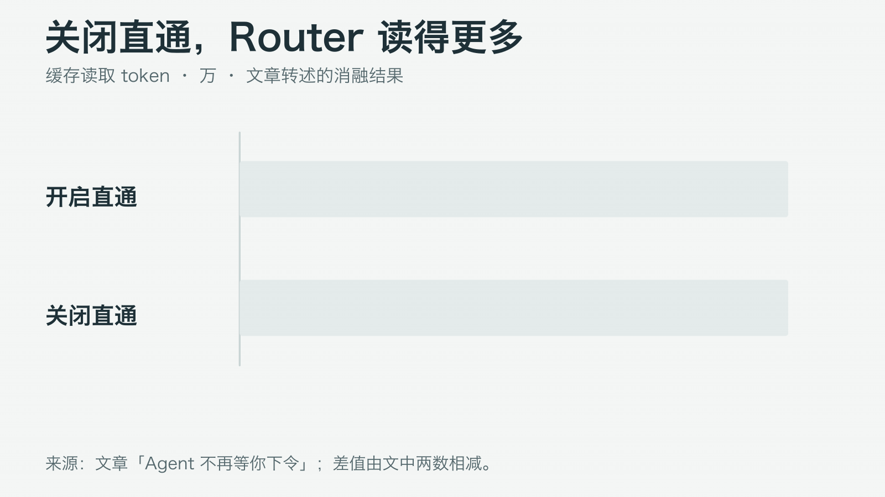<br>[原图](demo/style-data-newsroom.gif) · [场景](assets/examples/showcase/15-data-16x9.scene.mjs) |
| **档案时间轴风** · 三个虚构版本依次出现<br>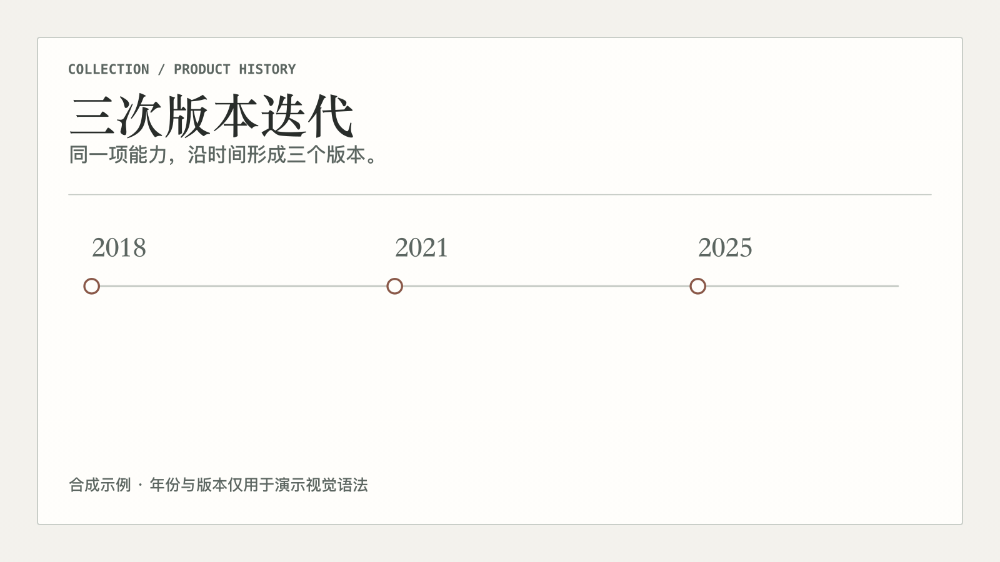<br>[原图](demo/style-archival-timeline.gif) · [场景](assets/examples/showcase/06-archival-timeline.scene.mjs) | **博物馆陈列风** · 先查原始材料再记结论<br>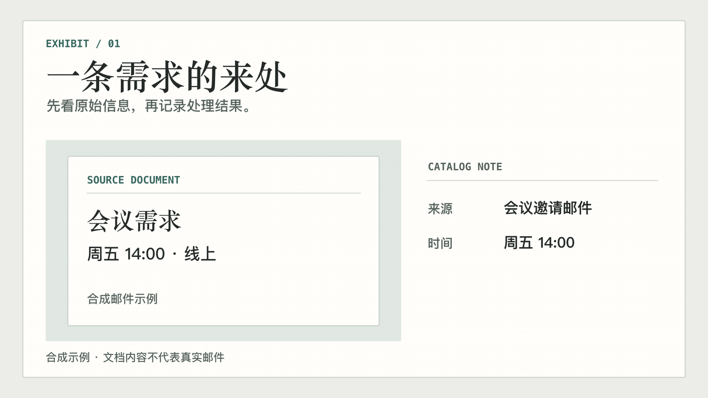<br>[原图](demo/style-museum-gallery.gif) · [场景](assets/examples/showcase/11-museum-gallery.scene.mjs) |
| **高对比海报风** · 多条路径汇成一个结果<br>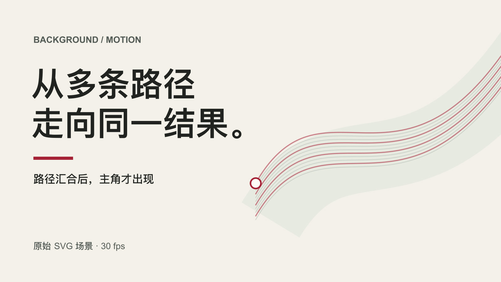<br>[原图](demo/background-ribbon-field-motion.gif) · [场景](assets/examples/backgrounds/ribbon-field-motion.scene.mjs) | |

内含 **9 套风格、10 种背景构图和 30 个语义组件**。同一批次统一视觉语言，不同比例重新构图。

### 风格与组件总览

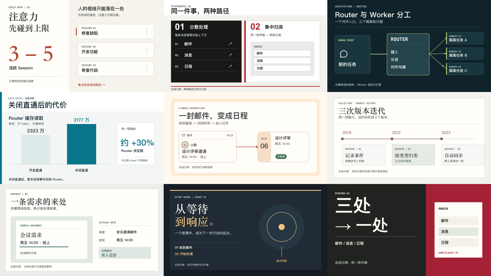

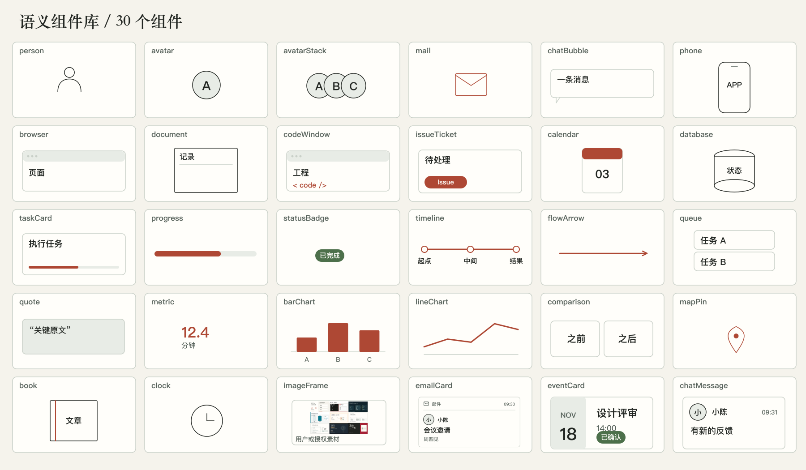

### 背景构图

总览图展示全部十种背景和其中六种的放大预览。下方每张 16:9 背景图都附有可编辑场景。[背景选择指南](references/backgrounds.md)


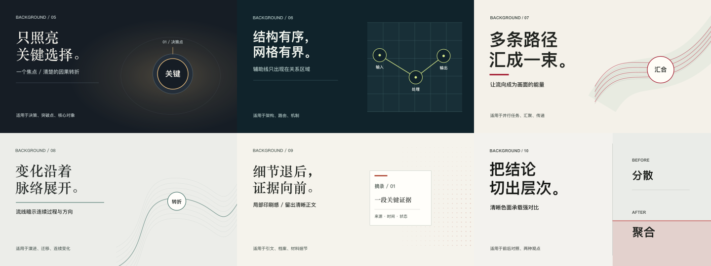

| | |
| --- | --- |
| **柔和光晕**<br><br>[场景](assets/examples/backgrounds/soft-wash.scene.mjs) | **边缘聚光**<br>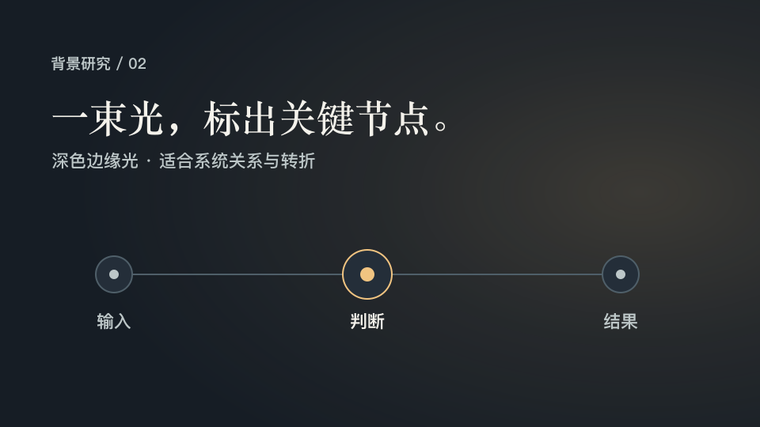<br>[场景](assets/examples/backgrounds/edge-glow.scene.mjs) |
| **层叠哑光**<br>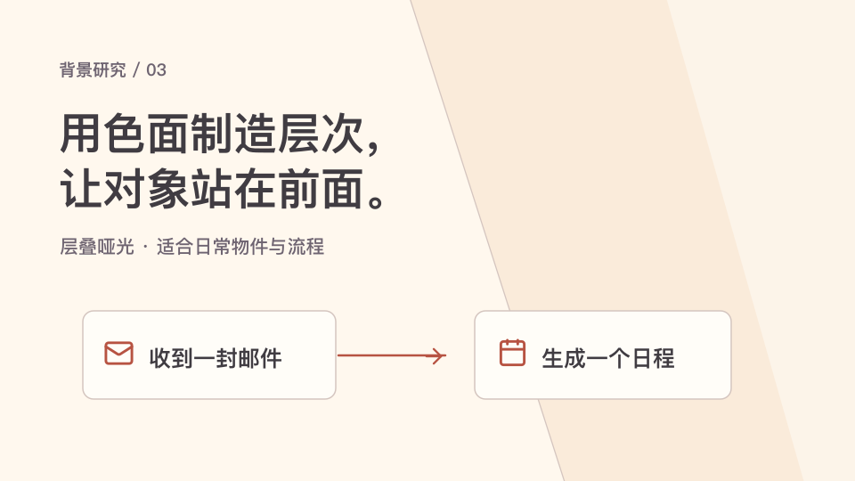<br>[场景](assets/examples/backgrounds/layered-matte.scene.mjs) | **局部纹样**<br><br>[场景](assets/examples/backgrounds/quiet-motif.scene.mjs) |
| **焦点光环**<br>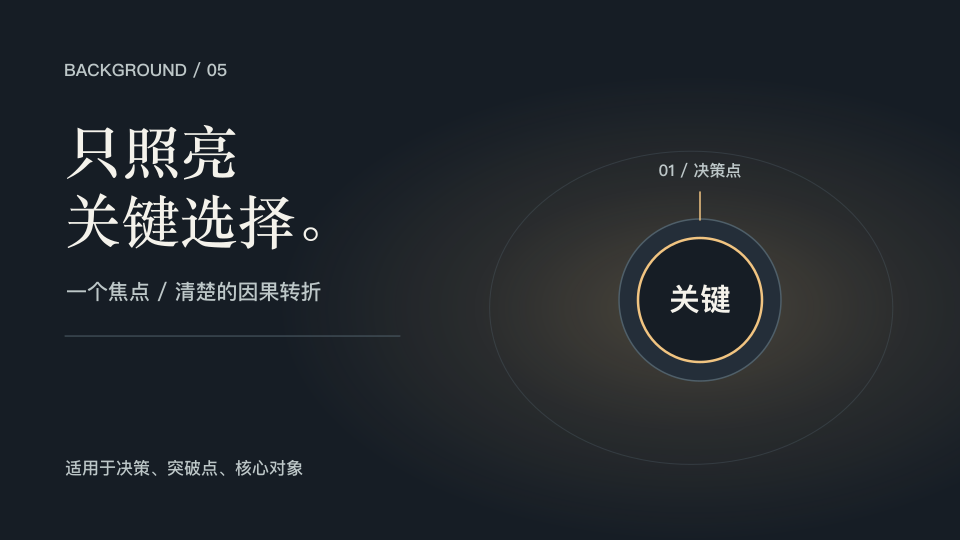<br>[场景](assets/examples/backgrounds/focus-halo.scene.mjs) | **裁切网格**<br>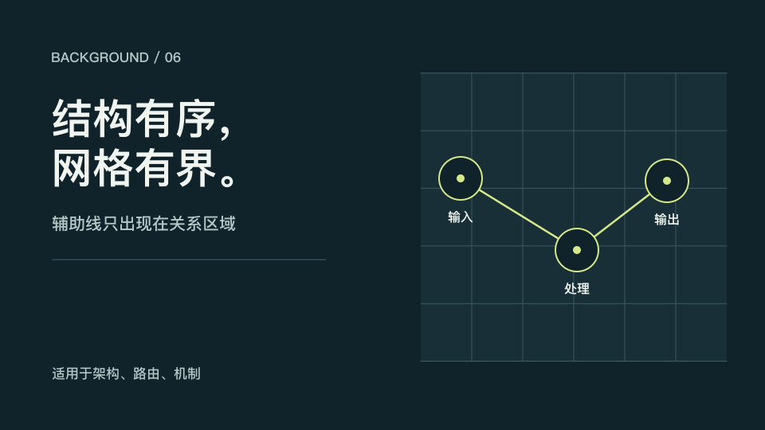<br>[场景](assets/examples/backgrounds/clipped-grid.scene.mjs) |
| **流动线束**<br>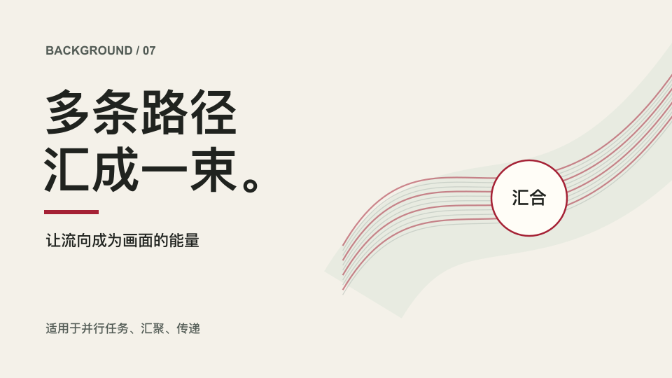<br>[场景](assets/examples/backgrounds/ribbon-field.scene.mjs) | **等高曲线**<br>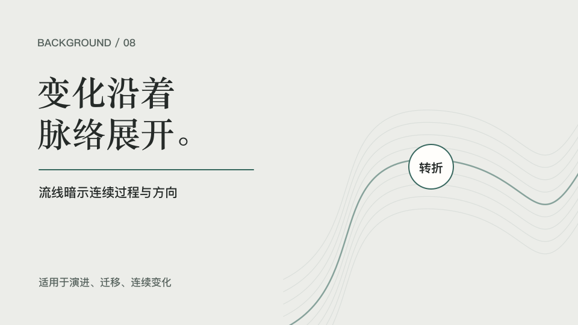<br>[场景](assets/examples/backgrounds/contour-lines.scene.mjs) |
| **半调边栏**<br>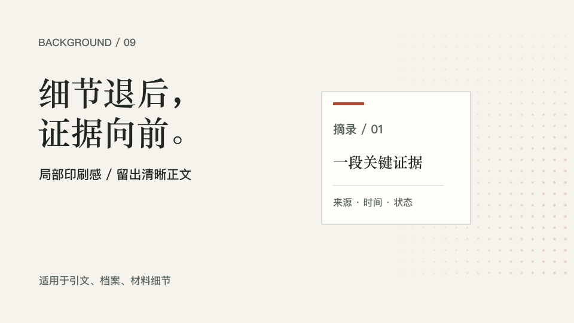<br>[场景](assets/examples/backgrounds/halftone-margin.scene.mjs) | **编辑色带**<br>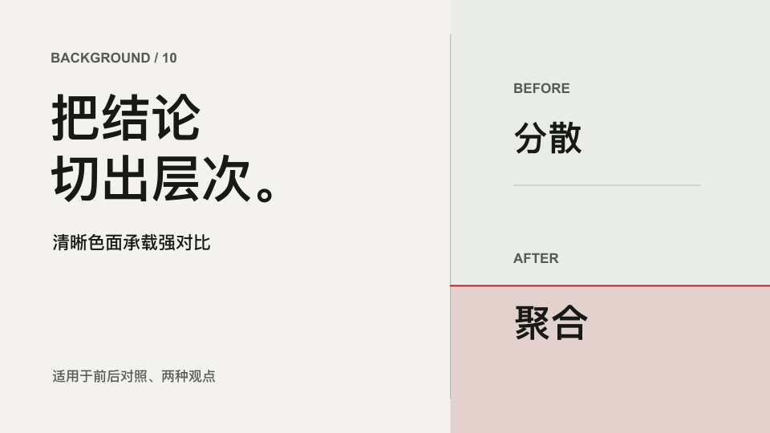<br>[场景](assets/examples/backgrounds/editorial-band.scene.mjs) |

### 竖屏示例

上方风格画廊保留 16:9；这里单独展示 9:16 的场景与背景如何重新构图。

| 邮件变日程 | 柔和光晕 | 焦点光环 |
| --- | --- | --- |
| <br>[原图](demo/08-email-9x16.gif) · [场景](assets/examples/showcase/08-email-9x16.scene.mjs) | <br>[场景](assets/examples/backgrounds/soft-wash-9x16.scene.mjs) | 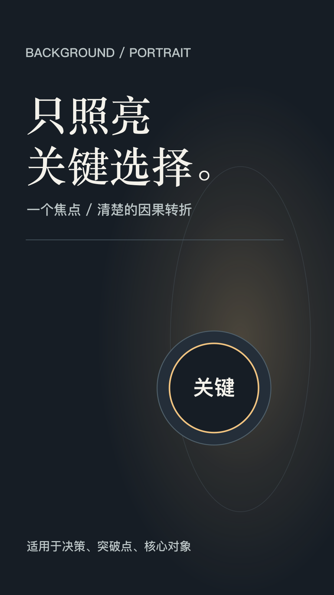<br>[场景](assets/examples/backgrounds/focus-halo-9x16.scene.mjs) |

默认输出为 **1600×900、30 fps、4–7 秒**；也支持 4:3、方图、9:16 和与场景比例一致的自定义尺寸。

## 设计脉络

一张解释型 GIF 只有几秒钟争取注意力。ExplainLoop 用字体建立主张、构图呈现关系、动画揭示变化。下列公开资料提供了设计方法；我们把方法转化为适合文章解读的原创场景。

| 设计师与资料 | 借鉴的方法 | 在 ExplainLoop 中的体现 |
| --- | --- | --- |
| [约瑟夫·穆勒-布罗克曼 · 瑞士网格](https://swissgrid.posterhouse.org/) | 灵活的网格让不同信息形成清楚的视觉关系。 | `swiss-grid` 用对齐的对照区域和标签，让读者一眼看懂两条路径。 |
| [扬·奇肖尔德 · 新字体设计](https://www.moma.org/calendar/exhibitions/1013) | 不对称排版、字号层级与留白先引导阅读。 | `editorial-paper` 和 `chromatic-poster` 让标题、重点与空白形成明确的阅读顺序。 |
| [马西莫·维涅里 ·《维涅里法典》](https://www.lars-mueller-publishers.com/vignelli-canon) | 语义、统一性、网格、字体和色彩组成一个有纪律的系统。 | 同一批 GIF 共用字体、配色、间距和动效节奏，每个主题仍有自己的构图。 |
| [爱德华·塔夫特 ·《定量信息的视觉显示》](https://www.edwardtufte.com/book/the-visual-display-of-quantitative-information/) | 图表应支持准确比较，避免视觉失真。 | `data-newsroom` 把单位和标签放在数据旁，对照条形从零开始，并保留原文限定。 |
| [奥托·诺伊拉特与格尔德·阿恩茨 · Isotype](https://www.cooperhewitt.org/2013/08/06/picturing-language/) | 一致的图像语言有助于理解复杂信息。 | 人物、消息、文档、任务、时间轴等语义组件各有清楚角色；内置图标素材另行注明来自 Lucide。 |
| [宝拉·谢尔 · *Type Is Image*](https://www.pentagram.com/news/paula-scher-type-is-image-opens-at-die-neue-sammlung) | 字体本身可以承担画面的情绪和识别性。 | `chromatic-poster` 让大字成为视觉主体，用字号和颜色突出文章观点。 |
| [索尔·巴斯 · 电影片头与海报](https://eyeondesign.aiga.org/design-history-101/) | 短暂的视觉序列也能浓缩一个较大的想法。 | 每段循环围绕一个可见的变化编排，并留下能独立读懂的结果画面。 |
| [迪特·拉姆斯 · 好设计原则](https://www.vitsoe.com/us/about/good-design) | 有用的细节应留下；无关的细节会遮挡信息。 | 当背景纹理、界面装饰或动效抢走文章主张的注意力时，就删减它们。 |

上表中的设计史资料用于说明方法，最后一列是 ExplainLoop 的具体转化。**项目中的场景和布局均为原创；上述设计师或机构与 ExplainLoop 没有合作或背书关系。**项目也未打包他们的作品或字体。[查看完整来源与许可证说明](references/sources-and-licenses.md)。

## 手动安装与运行环境

渲染需要 Node.js 20+、`rsvg-convert`（[librsvg](https://wiki.gnome.org/Projects/LibRsvg)）、`ffmpeg` 和 `ffprobe`（[FFmpeg](https://ffmpeg.org/)）。上方的 Skills CLI 另需 Node.js 22.20+。项目不打包字体；重渲中文示例时请安装合适的中文字体。

```bash
git clone https://github.com/GraySilver/explainloop.git
cd explainloop
mkdir -p "$HOME/.codex/skills"
ln -s "$PWD" "$HOME/.codex/skills/explainloop"
```

Claude Code 的目标目录改为 `"$HOME/.claude/skills/explainloop"`。已有同名目录时先备份；若安装后未被发现，重启 Agent。

在仓库根目录渲染示例：

```bash
node scripts/render.mjs \
  --scene "$PWD/assets/examples/showcase/21-one-coordinator.scene.mjs" \
  --out "$PWD/example.gif" --output-size 1600x900
node scripts/inspect.mjs "$PWD/example.gif"
```

运行 `node scripts/test.mjs` 检查渲染器、场景、多比例与批次规则。

## 授权与来源

原创代码、Skill 指令与示例画面采用 [MIT 许可证](LICENSE)。内置 Lucide 图标保留原有的 [ISC/MIT 声明](assets/icons/LICENSE)与[来源记录](assets/icons/PROVENANCE.md)。设计参考见[来源说明](references/sources-and-licenses.md)；项目不打包第三方作品或字体文件。
